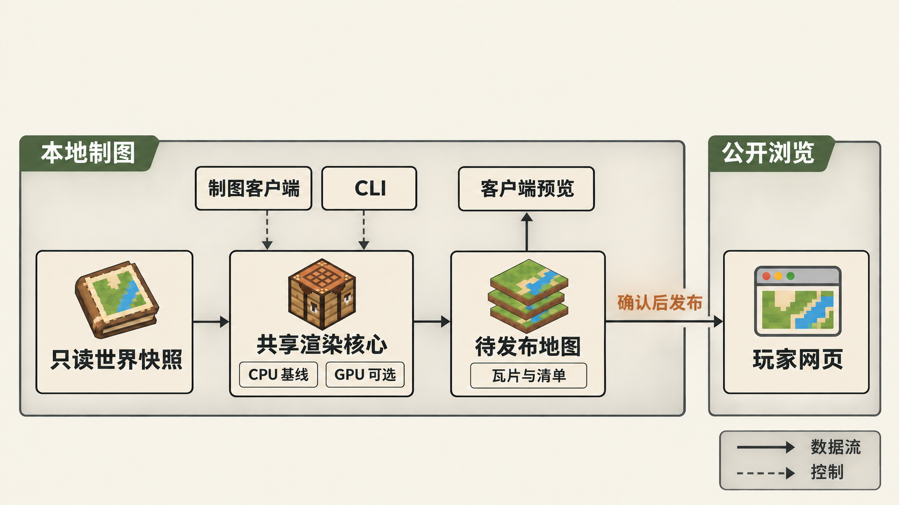

# TongCraft 离线 GPU 地图：从世界快照到静态二维瓦片

**状态：架构提案，尚未实现或跑分。** 目标是替换 BlueMap 的平面地图用途：定期接收一致、只读的 Fabric 世界快照，在独立机器离线制图，发布主世界、下界、末地的静态地图。游戏服务器不装模组，不采集实时玩家位置；访客无须 WebGL、WebGPU 或 Wasm。成功不是“用到了 GPU”，而是同一份快照能更快或更省成本地生成正确的地图，并保持官网已有坐标链接可用。

具体模块接口、存档兼容边界、坐标与发布协议见 [v1 详细设计](design-v1.md)，备选方案和重议条件见[技术选型 ADR](decisions/2026-11-20-offline-map-stack.md)。

## 一、架构与分工

制图客户端和 CLI 共用同一个离线渲染核心。核心读取只读世界快照，提取地表后使用 CPU 或可选 GPU 后端着色，再编码为静态瓦片。维护者预览并确认后才发布；玩家网站读取已发布的瓦片、版本清单和公开机器标记，不接触世界存档。

**图 1：TongCraft Map 架构总览**

[查看架构图内容清单](diagrams/overview.brief.md)，包括图内标签和连线说明。

**已采纳：[Tauri 2 制图客户端与独立 CLI 共用 Rust 渲染核心](decisions/2026-11-20-desktop-renderer.md)。** 桌面端负责选档、任务控制和 Leaflet 预览；核心不依赖窗口，支持 CPU 和可选 GPU 后端。 GPU 层用 [wgpu](https://docs.rs/wgpu/) + WGSL 计算着色器，不建窗口；Windows 优先验证 D3D12，Linux 优先验证 Vulkan。不限定显卡品牌，也不预设集显或无桌面驱动一定可用。相比 Go 主程序再跨语言调用 GPU，这条路线让缓冲区格式、批处理调度、CPU 对照测试都留在一个程序里。浏览器端独立部署；换渲染后端无需改网站。

| 模块（拟建） | 输入 → 输出 | 设计边界 |
|---|---|---|
| `world-reader` | 快照 → 带坐标的 chunk/section | 依据实际 DataVersion 和样本验证兼容；不假定所有快照使用相同目录与压缩方式。未知格式或损坏区块须报维度、坐标，不能静默当空气发布 |
| `surface` | chunk → 紧凑的列数据 | 共用方块调色板；每列存表层材质、高度、水深、着色参数和有效位。不上传整份 NBT，不把缺失块和高度 0 混淆 |
| `raster-cpu` / `raster-gpu` | 同一批列 → 同尺寸 RGBA | CPU 是正确性基线。GPU 第一阶段负责查色、水色混合、相邻高度阴影；缩小层级是否放 GPU，由测量决定 |
| `pyramid` / `publish` | RGBA → 按维度组织的瓦片、清单、校验值 | 256×256 无损 PNG 起步；不生成全世界巨幅画布，不发布世界原档、玩家或实体 NBT |
| `web` | 清单 + 可见瓦片 + 公开标记 → 地图 | 三维度切换、搜索机器、显示 X/Z、复制链接；Y 只用于详情，不参与平面定位 |

## 二、GPU 怎样工作、何时不用

- 不为每个 chunk 开一次 GPU 任务。CPU 把相邻瓦片连同一圈邻列合批上传；每个 GPU 线程处理一个输出像素。邻列用于计算坡度，避免瓦片边缘出现拼接线。透明/未生成区域单独标记。
- 复用上传与读回缓冲区；按设备的缓冲区上限和可用内存控制批大小。解码、计算和 PNG 编码通过有界队列衔接，避免 GPU 等磁盘，或编码跟不上时持续占用内存。先实现简单批处理，再根据测量决定是否双缓冲和异步读回。
- 提供 `--backend cpu|gpu|auto`：`cpu` 不初始化显卡；`gpu` 无合格硬件或设备丢失时明确失败，便于验证真用了硬件；`auto` 可重试当前未完成批次到 CPU。记录实际适配器、后端、回退原因；软件适配器不计作硬件加速。
- **收益门槛**：同机、同快照、同配色、同编码设置测全量与日常增量，分别记录扫描/解压、提取列、上传、GPU 计算、读回、编码、写盘及端到端墙钟时间。区分冷/热缓存，重复运行取中位数，并记录峰值内存。GPU 若只让着色变快却不缩短整次出图，就保留为可选项；少量变化走 CPU。若瓶颈在列扫描，再单独对比“上传紧凑 section、GPU 扫列”与现方案，而不是直接上传整份世界。

## 三、地图与网站的数据契约

- **地表规则先于性能**：主世界顶视地表，明确定义水、叶、玻璃、雪及未知模组方块的样式；未知方块使用可见的回退色并计数。下界不能简单取最高非空气方块，否则容易只画出基岩顶。用真实样本对照“屋顶层 / 指定高度以下地表”选默认，可将屋顶交通单独做图层。末地未生成区保持透明，不填成陆地。
- **坐标固定，不随地图扩张平移**：以 `(X=0,Z=0)` 为固定原点，X 向右、Z 向下；最高原生层每像素一方块。举例：最高层瓦片索引为 `floor(X/256), floor(Z/256)`，`X=-1` 在第 `-1` 张瓦片，不是第 `0` 张。父层索引也用向下取整；清单显式给出各层方块/像素比例，Leaflet 用对应缩放变换和 `[-Z,X]` 定位，不能只翻转轴而忽略比例。三个维度使用各自原始坐标，不自动做 8:1 换算。
- **产物**：每一版清单给出快照日期、维度 ID、范围、原点、层级、瓦片路径规则、标记版本与缺失瓦片处理；稀疏区域按需返回透明瓦片或由覆盖索引跳过。用户只下载当前视口所需图片。
- **老链接**：保留官网生成的 `#world_nether:X:Y:Z:200:0:0:0:1:flat` 等格式，解析维度、X、Z；不能把视角高度当 Z。依据：[官网链接生成逻辑](https://github.com/TongCraft/tongcraft.github.io/blob/main/scripts/machines.mjs#L16)、[现有坐标测试](https://github.com/TongCraft/tongcraft.github.io/blob/main/test/machines.test.mjs#L13)（官网源码仓库需授权访问）。标记复用官网构建生成的数据，仅导出明确允许公开的字段。

## 四、增量与发布

首次全量出图，后续比较快照。起步可对 region 做内容摘要，不能仅靠文件时间；单文件变化先允许重算整个 region，证明成本过高再细化至 chunk。变更或删除要使受影响的最高层瓦片、阴影相邻边缘及祖先瓦片失效；调色板、切层、算法版本也参与缓存键。验收时比较“增量后的最终产物”与“同一快照从零构建”的解码像素和稀疏覆盖范围。

先本地静态目录验证，再接现有托管或对象存储。写新版本到独立目录，校验清单引用和抽样瓦片后，最后替换短缓存入口清单；版本瓦片才用长期不可变缓存。第一版优先发布完整可读的新版本，不要让新清单只含改动文件却丢失未变瓦片；存储或上传成本显著时再做内容去重。保留旧版本以便回滚。原始存档在私有渲染机处理，公开资源白名单发布。

## 五、实施顺序与验收

| 阶段 | 交付 | 通过条件 |
|---|---|---|
| 1. 样本与 CPU 基线 | 取得脱敏导出样本、确认 DataVersion、显卡/驱动、内存及预期出图窗口；先做小范围 CPU 渲染 | 选取已知机器、负坐标、跨 region 地形、水面、下界屋顶和末地空区；人工确认位置和画法，建立参考瓦片 |
| 2. GPU 小样 | 同一输入运行 CPU 和真实 GPU，分阶段计时 | 使用固定整数着色与舍入规则，逐像素比较解码后的 RGBA；跨边界无接缝，禁用 GPU 后结果不变。记录整次耗时，不以单个着色器跑分代替 |
| 3. 静态网站 | 一小片真实地图、机器标记、旧深链兼容，以临时地址预览 | 桌面/手机可平移缩放；跨维度、零/负坐标和旧链接准确；不开 WebGL 也能用，首屏不拉全图 |
| 4. 全量与增量 | 三维度批处理，发布校验、清单切换及回滚演练 | 真实规模下资源不越预算；模拟修改、删除、设备丢失、发布中断；未完成版本不可见，旧链接仍可用 |
| 5. 并行上线 | 与 BlueMap 对照相同坐标、尺寸和冷缓存首屏，记录传输量、首批瓦片可见时间与手机操作体验 | 地图维护者确认下界层和颜色可接受，出图窗口达标，再切正式入口；首个更新周期保留 BlueMap 回退 |

**下一步所需最小输入**：实际离线渲染机的系统和 GPU 型号、一个可本地使用的代表性快照样本，以及几个已知坐标。无需上传整服存档。先回答“画得对吗、时间花在哪”，再决定 GPU 默认策略和正式托管方式。
